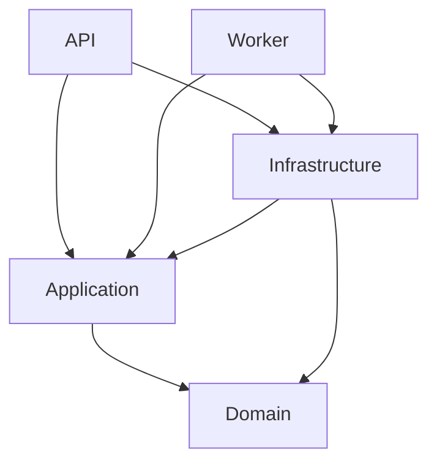
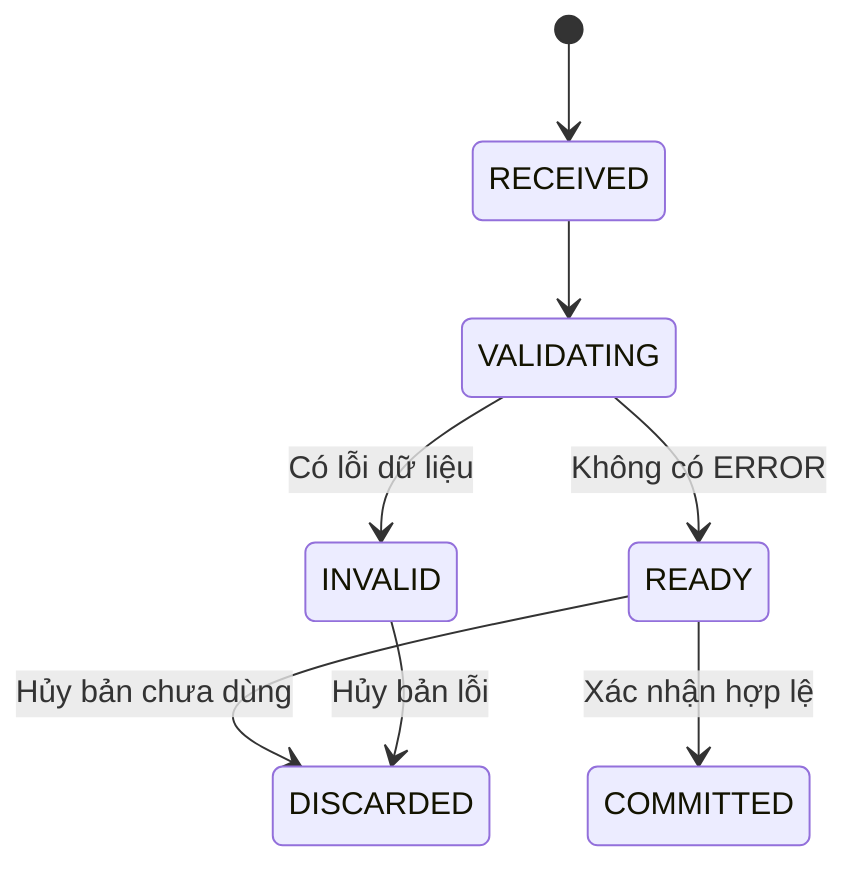

**Finance–Logistics — Hướng dẫn A–Z triển khai mốc đầu tiên**

Ngày: 05/10/2026. Dành cho một dev C#/.NET triển khai nội bộ trên Windows và SQL Server.

**Đích đến:** đăng nhập bằng tài khoản công ty → chọn kỳ → upload PO_UPDATED → xem dữ liệu/lỗi → xác nhận → nộp bản sửa → truy lại bản cũ.

Tài liệu này hướng dẫn cách tự triển khai. Gói đi kèm cung cấp Identity hiện có, bộ tạo solution, ví dụ Domain/Application/EF và DDL import. Gói CHƯA có toàn bộ endpoint upload, parser, worker và màn hình PO. Các phần cần viết tiếp được đánh dấu rõ trong từng bước. Không xem việc tạo được solution là đã hoàn thành mốc đầu tiên.

**1. Những quyết định áp dụng ngay**

| Nội dung | Quyết định |
|---|---|
| Backend | ASP.NET Core Web API, .NET 10 LTS, Controllers |
| Database/access | SQL Server; EF Core; schema thay đổi bằng script SQL có phiên bản |
| Frontend | HTML/CSS/JavaScript modules hiện có, phục vụ từ wwwroot cùng origin với API |
| Kiến trúc | Một hệ thống chia module; áp dụng hướng phụ thuộc của Clean Architecture cho phần PO mới |
| Identity | Tiếp tục form AD + JWT/phiên của Identity V1.1; chưa di chuyển toàn bộ module đang có sang các project mới |
| Xử lý import | API nhận file và ghi job bền vững trong SQL; Worker đọc file, kiểm tra và ghi kết quả |
| Upload lại | Snapshot: thay bản đang dùng sau xác nhận, giữ tất cả bản cũ |
| Báo cáo | Sau mốc này mới triển khai ghép PO_receipt 59 cột |
| Công cụ phát triển chính | VS Code + .NET CLI; có hướng dẫn mở/tạo bằng Visual Studio 2026 |
| Aspire | Có thể thêm sau khi API/Worker ổn định; không phải điều kiện để bắt đầu |

Mốc này chỉ bật nghiệp vụ PO_UPDATED/FINANCE_SHARED. Các danh mục nguồn khác có thể đã tồn tại nhưng UI cần thể hiện rõ tính năng nào đã được triển khai; không tạo email nhắc người dùng cho các luồng chưa bàn giao.

**2. System design và Clean Architecture nghĩa là gì trong dự án của bạn?**

System design là quyết định toàn hệ thống vận hành ra sao: file ở đâu, ai được xem, việc nào chạy nền, mất mạng xử lý thế nào, một báo cáo dùng bản nguồn nào. Đây là việc phải làm ngay, dù chỉ có một dev.

Clean Architecture là cách đặt code và hướng phụ thuộc để công thức/nghiệp vụ ít bị dính vào HTTP, SQL hoặc thư viện Excel. Nguyên tắc phụ thuộc hướng vào nghiệp vụ được Microsoft mô tả trong tài liệu kiến trúc; số project và cách chia module dưới đây là lựa chọn riêng cho dự án này.

| Project | Cách hiểu đời thường | Ví dụ |
|---|---|---|
| FinanceLogistics.Domain | Nội quy nghiệp vụ | Batch còn lỗi thì không được xác nhận; kỳ đóng thì không nhận thay đổi |
| FinanceLogistics.Application | Quy trình xử lý công việc | Nhận lệnh xác nhận, phối hợp kiểm tra và lưu kết quả qua interface |
| FinanceLogistics.Infrastructure | Người thực hiện thao tác kỹ thuật | SQL, EF Core, lưu file, đọc CSV/Excel |
| FinanceLogistics.Api | Quầy tiếp nhận yêu cầu | Controller, HTTP, lấy người dùng đã đăng nhập, trả DTO |
| FinanceLogistics.Worker | Bộ phận xử lý nền | Lấy job đang chờ và gọi quy trình import; thêm khi đến bước 15 |

Hướng reference cho code mới:



API reference Infrastructure để đăng ký implementation trong Program.cs. Controller của chức năng mới vẫn gọi Application, không tự mở SQL connection để xử lý nghiệp vụ.

Domain không reference EF/ASP.NET. Application không nhận IFormFile hoặc HttpContext; nó nhận Stream/DTO và actor được API xác thực. Infrastructure implement các interface Application định nghĩa. Worker không reference project API.

Ví dụ IPoConfirmationStore thuộc Application, SqlPoConfirmationStore thuộc Infrastructure. Khi chạy, dependency injection cung cấp SqlPoConfirmationStore cho ConfirmPoImport.

Identity V1.1 hiện nằm trong API theo cấu trúc Controller/Service/Repository. Giữ nguyên đường đi này trong mốc đầu để tránh vừa đổi xác thực vừa viết import. Như vậy solution đang chuyển dần sang cấu trúc mới, không phải mọi module đã tuân thủ Clean Architecture hoàn toàn. Khi refactor Identity, tách theo module và chạy lại kiểm tra đăng nhập/quyền; không kéo ELeaveDbContext/TimeKeeping vào Domain.

**3. Những quyết định system design cần ghi thành tài liệu ngắn**

| Câu hỏi | Cách làm trong mốc này |
|---|---|
| Người dùng được làm gì? | Finance nộp/xác nhận PO; Logistics không được truy cập PO Finance; quản trị kỹ thuật cần được cấp thêm FINANCE nếu làm nghiệp vụ |
| Kỳ được chọn thế nào? | Chọn từ database; backend kiểm tra kỳ OPEN khi thay đổi |
| Dữ liệu một dòng PO là gì? | Một dòng trong nguồn PO_UPDATED; có khóa kỹ thuật riêng, không lấy riêng InvoiceNumber làm khóa chính |
| Preview có ảnh hưởng báo cáo chưa? | Chưa; chỉ ActiveBatchId của yêu cầu nộp quyết định bản đang dùng |
| Nộp lại xử lý ra sao? | Tạo batch mới; confirm chuyển con trỏ đang dùng; giữ batch cũ |
| Mất response khi upload? | ClientUploadId + fingerprint và hash giúp nhận lại batch thay vì tạo bản trùng |
| Hai người confirm cùng lúc? | RowVersion của requirement và transaction có kiểm tra trạng thái hiện tại |
| Website/Worker dừng? | Job và trạng thái lưu SQL; worker khác hoặc lần khởi động sau nhận lại job theo lease |
| File gốc lưu đâu? | Kho riêng ngoài wwwroot; SQL giữ StorageKey và metadata |
| Báo cáo sau này dùng dữ liệu gì? | Bộ BatchId cố định + MappingVersion + snapshot tham chiếu |

Giới hạn kỹ thuật ban đầu cho bộ thử: tối đa 10 MB/file, 10.000 dòng dữ liệu, preview 50 dòng/trang và trần 100 dòng/trang. Đây là cấu hình để hoàn thiện luồng và đo hiệu năng, chưa phải cam kết đáp ứng toàn bộ file thật. Thu thập kích thước/số dòng lớn nhất trước UAT để điều chỉnh.

**4. Cài môi trường trên máy Windows**

| Thành phần | Việc làm | Kiểm tra |
|---|---|---|
| .NET | Dùng SDK 10 ổn định bạn đã cài | dotnet --info; dotnet --list-sdks |
| VS Code | Cài extension C# của Microsoft; dùng C# Dev Kit theo quyền sử dụng công ty cấp nếu có | Mở được .csproj, build/debug được |
| Visual Studio nếu dùng | Visual Studio 2026, workload ASP.NET and web development | Có .NET 10 trong Target Framework |
| SQL Server | Một instance dev được công ty cấp, phiên bản phù hợp provider; tài liệu lấy SQL Server 2022 làm môi trường tham chiếu | Kết nối bằng SSMS |
| SSMS | Dùng để tạo database, chạy migration, xem dữ liệu | Query được SELECT @@VERSION |
| Git | Theo dõi source/migration | git --version |
| Node.js | Chỉ cần để chạy các kiểm tra frontend đi kèm | node --version |

Microsoft hỗ trợ target net10.0 bằng Visual Studio 18.0 trở lên (Visual Studio 2026); cài SDK 10 không tự biến Visual Studio 2022 thành IDE hỗ trợ đầy đủ target này. VS Code chạy lệnh dotnet trực tiếp.

Mở PowerShell:

```powershell
dotnet --info
dotnet --list-sdks
git --version
node --version
```

Cần nhìn thấy SDK 10.0.xxx ổn định. 10.0.4xx là số phiên bản SDK; 10.0.12 là phiên bản package/runtime, không nhập 10.0.12 vào global.json như một SDK.

Máy chạy API phải truy cập được SQL và AD của công ty. Mở được trang login chỉ xác nhận website hoạt động; đăng nhập thật cần DNS/domain/trust và tài khoản được provision.

**5. Cách tạo workspace nên dùng: tận dụng bộ Identity**

Giải nén Finance_Logistics_Moc1_Tutorial.zip vào D:\Acer_Project\FL_Moc1_Tutorial. Tìm thư mục chứa Initialize-Workspace.ps1, mở PowerShell tại đó, đọc script rồi chạy:

```powershell
.\Initialize-Workspace.ps1 -Destination 'D:\Acer_Project\FinanceLogistics_DEV'
Set-Location 'D:\Acer_Project\FinanceLogistics_DEV'
code .
```

Thư mục đích phải chưa tồn tại. Script chỉ tạo workspace mới, không sửa E-Leave, không chạy SQL hoặc thay đổi AD. Nếu công ty chặn PowerShell script, dùng các lệnh thủ công ở bước 6 hoặc quy trình chạy script được IT cho phép.

Script thực hiện: copy Identity, tạo solution .sln, tạo ba class library, nối reference, thêm ví dụ và cấu hình VS Code, thêm project checks, chọn SDK 10 đã cài và build. Nó cập nhật package Microsoft của bản sao API/Infrastructure lên 10.0.12. Module PO chưa được đăng ký chạy trong API.

| Đường dẫn sau khởi tạo | Nội dung |
|---|---|
| FinanceLogistics.sln | Mở toàn solution trong Visual Studio hoặc VS Code |
| global.json | SDK của workspace; không tác động E-Leave ở thư mục khác |
| src/FinanceLogistics.Api | Identity và frontend hiện có; nơi bổ sung controller/màn hình PO |
| src/FinanceLogistics.Domain | Entity PO và ví dụ quy tắc confirm |
| src/FinanceLogistics.Application | Port và use case confirm mẫu |
| src/FinanceLogistics.Infrastructure | ImportDbContext/Fluent Mapping mẫu |
| database | Script Identity 001–003 và import 004 |
| tests/Identity.Checks | Kiểm tra C# của Identity |
| tests/Workflow.Checks | 13 tình huống kiểm tra quy tắc confirm |
| tests/frontend | Kiểm tra JavaScript của Identity |
| .vscode | Cấu hình build và F5 API |

Sau khi build:

```powershell
dotnet run --project tests/Workflow.Checks/Workflow.Checks.csproj
dotnet run --project tests/Identity.Checks/Identity.Checks.csproj
node --test tests/frontend/identity.test.mjs
```

Workflow.Checks và Identity.Checks là console checks, vì vậy chạy bằng dotnet run. Không diễn giải việc dotnet test chạy 0 tests là đã kiểm tra hai project này.

Nếu script dừng ở restore/build do proxy/NuGet/SDK, workspace đã tạo vẫn còn. Xem lỗi, sửa cấu hình rồi chạy lại dotnet restore/build tại workspace; không chạy ép đè cả thư mục.

**6. Tự gõ lệnh tạo solution trong VS Code để hiểu cơ chế**

Đây là cách làm thay cho bước 5. Chạy trong một thư mục dự án MỚI sau khi đã copy các thư mục src/database/tests/docs của Identity baseline vào đó. API Identity đã có thì không chạy dotnet new webapi chồng lên nó.

```powershell
dotnet new sln -n FinanceLogistics --format sln
dotnet new classlib -n FinanceLogistics.Domain -o src/FinanceLogistics.Domain -f net10.0
dotnet new classlib -n FinanceLogistics.Application -o src/FinanceLogistics.Application -f net10.0
dotnet new classlib -n FinanceLogistics.Infrastructure -o src/FinanceLogistics.Infrastructure -f net10.0

dotnet add src/FinanceLogistics.Application reference src/FinanceLogistics.Domain
dotnet add src/FinanceLogistics.Infrastructure reference src/FinanceLogistics.Application
dotnet add src/FinanceLogistics.Infrastructure reference src/FinanceLogistics.Domain
dotnet add src/FinanceLogistics.Api reference src/FinanceLogistics.Application
dotnet add src/FinanceLogistics.Api reference src/FinanceLogistics.Infrastructure

dotnet sln FinanceLogistics.sln add src/FinanceLogistics.Api/FinanceLogistics.Api.csproj
dotnet sln FinanceLogistics.sln add src/FinanceLogistics.Domain/FinanceLogistics.Domain.csproj
dotnet sln FinanceLogistics.sln add src/FinanceLogistics.Application/FinanceLogistics.Application.csproj
dotnet sln FinanceLogistics.sln add src/FinanceLogistics.Infrastructure/FinanceLogistics.Infrastructure.csproj
dotnet sln FinanceLogistics.sln add tests/Identity.Checks/Identity.Checks.csproj

dotnet add src/FinanceLogistics.Infrastructure package Microsoft.EntityFrameworkCore.SqlServer --version 10.0.12
dotnet add src/FinanceLogistics.Api package Microsoft.EntityFrameworkCore.SqlServer --version 10.0.12
dotnet add src/FinanceLogistics.Api package Microsoft.AspNetCore.Authentication.JwtBearer --version 10.0.12
dotnet add src/FinanceLogistics.Api package System.DirectoryServices.AccountManagement --version 10.0.12
dotnet restore FinanceLogistics.sln
dotnet build FinanceLogistics.sln --no-restore
```

Class1.cs của các class library mới có thể xóa khi bắt đầu thêm entity/use case. Để có các ví dụ và debug config giống bộ khởi tạo, copy nội dung supplements vào đúng các thư mục tương ứng và copy database/004 từ gói.

Nếu thật sự tạo API hoàn toàn từ đầu trong một workspace khác, lệnh là:

```powershell
dotnet new webapi -n FinanceLogistics.Api -o src/FinanceLogistics.Api -f net10.0 --use-controllers
```

API vừa tạo chỉ là template. Muốn tái sử dụng AD adapter hiện có cần net10.0-windows trong csproj, package/config/Program.cs/Identity source tương ứng. Không ghép thêm một AuthController thứ hai bên cạnh AuthController đang có. Vì vậy đường chính của tài liệu là tiếp tục Identity baseline.

**7. Nếu thích Visual Studio**

Cách nhanh: dùng bước 5 rồi mở FinanceLogistics.sln trong Visual Studio 2026. Right-click FinanceLogistics.Api → Set as Startup Project → chọn profile https → F5.

Cách tạo bằng UI trong thư mục mới:

1. Create a new project → Blank Solution → FinanceLogistics.
2. Add → Existing Project → chọn FinanceLogistics.Api.csproj trong bản sao Identity.
3. Add → New Project → Class Library → lần lượt Domain, Application, Infrastructure, .NET 10.
4. Right-click Dependencies → Add Project Reference; chọn đúng hướng trong sơ đồ bước 2.
5. Manage NuGet Packages → cài EF Core SQL Server ở Infrastructure; thống nhất nhánh 10.0.x với API.
6. Add Existing Project cho tests/Identity.Checks nếu muốn chạy checks cùng solution.
7. Đặt API làm startup, kiểm tra HTTPS profile, build solution.

Nếu tạo Web API bằng UI từ số 0: ASP.NET Core Web API, .NET 10, Authentication Type = None, Configure for HTTPS bật, Use controllers bật. None chỉ có nghĩa không sinh sẵn cơ chế xác thực của template; bạn vẫn phải tích hợp module AD + JWT. Không chọn Windows Authentication với kỳ vọng nó giống form đăng nhập E-Leave.

**8. Tạo database và chạy Identity trước**

Trong SSMS, tạo database DEV riêng theo quyền được cấp. Ví dụ khi có quyền CREATE DATABASE:

```sql
USE master;
IF DB_ID(N'FinanceLogistics_Dev') IS NULL
    EXEC(N'CREATE DATABASE FinanceLogistics_Dev');
GO
USE FinanceLogistics_Dev;
SELECT DB_NAME() AS CurrentDatabase, @@VERSION AS SqlVersion;
```

Thứ tự cho database DEV mới:

1. database/001_identity_schema.sql.
2. database/002_catalog.sql.
3. Điền database/003_provision_user_TEMPLATE.sql, tạo SYSTEM_ADMIN đầu tiên, sau đó tài khoản Finance test.
4. Sau khi login hoạt động, chạy database/004_po_import_schema.sql để thêm import.

001/002 của Identity có guard tạo phần còn thiếu. 004 của tutorial dành cho database CHƯA có các bảng import; nó dừng nếu gặp bảng đã tồn tại. Nếu bạn đã chạy full schema V1 hoặc đã tùy biến DB, so sánh schema và viết migration chênh lệch; không chạy toàn bộ file CREATE TABLE chồng lên nhau.

V1 dùng SQL script làm nguồn thay đổi schema. Entity/Fluent Mapping đi theo script. Không chạy EnsureCreated hoặc EF Database.Migrate ở startup trong quy trình này.

Account chạy DDL và account ứng dụng tách nhau khi lên UAT/production. Khi dev bằng Integrated Security, SQL nhìn thấy tài khoản Windows đang chạy API; khi lên IIS nó thường là identity của app pool. Đăng nhập ứng dụng bằng tài khoản Finance không đồng nghĩa SQL connection dùng tài khoản Finance đó.

**9. Cấu hình AD và đăng nhập**

Từ IT/AD cần: domain hoặc DC, NetBIOS domain, SearchBase DN nếu dùng, SAM/UPN/SID của các tài khoản test. Không lấy SID do frontend gửi và không đoán domain từ đuôi email.

003_provision_user_TEMPLATE.sql yêu cầu người cấp quyền là admin đã tồn tại; một user đã link DirectoryAccount không được provision lại bằng cùng script. Nếu dùng một người cho cả SYSTEM_ADMIN và FINANCE ở DEV, thêm role FINANCE bằng script quản trị riêng sau khi kiểm tra đúng UserId; không chạy lại 003 rồi bỏ qua lỗi.

Tại workspace:

```powershell
$apiProject = 'src/FinanceLogistics.Api/FinanceLogistics.Api.csproj'
dotnet user-secrets set 'ConnectionStrings:FinanceLogistics' 'Server=<SQL_HOST>;Database=FinanceLogistics_Dev;Integrated Security=True;Encrypt=True;TrustServerCertificate=False;' --project $apiProject
dotnet user-secrets set 'Identity:Directories:CORPORATE:DomainName' '<AD_DOMAIN_OR_DC>' --project $apiProject
dotnet user-secrets set 'Identity:Directories:CORPORATE:NetBiosName' '<DOMAIN_NETBIOS>' --project $apiProject
dotnet user-secrets set 'Identity:Directories:CORPORATE:SearchBaseDn' '<SEARCH_BASE_DN>' --project $apiProject

$keyDirectory = Join-Path $env:LOCALAPPDATA 'FinanceLogistics\Keys'
dotnet user-secrets set 'Identity:KeyRingPath' $keyDirectory --project $apiProject
$signingBytes = New-Object byte[] 32
$cryptoProvider = [System.Security.Cryptography.RandomNumberGenerator]::Create()
$cryptoProvider.GetBytes($signingBytes)
dotnet user-secrets set 'Identity:SigningKeyBase64' ([Convert]::ToBase64String($signingBytes)) --project $apiProject
$cryptoProvider.Dispose()

dotnet dev-certs https --trust
dotnet run --project $apiProject --launch-profile https
```

Thay placeholder bằng thông tin thật. Directory key CORPORATE phải khớp sec.DirectoryAccount.DirectoryKey. Baseline đã có UserSecretsId nên không cần init lại. User Secrets phục vụ dev, không tự mã hóa và không được copy vào Git. Không dùng mật khẩu AD làm JWT key.

Với SQL local có certificate tự ký, có thể dùng TrustServerCertificate=True CHỈ trong cấu hình dev đã xác định; production dùng certificate được tin cậy. Không bỏ xác thực AD khi lỗi DNS/SQL/certificate.

Mở https://localhost:7243/login.html. HTML được API phục vụ cùng origin; không mở file:// hoặc dùng Live Server khác port cho luồng này.

Điểm đạt: đăng nhập Finance thành công, /api/me trả role FINANCE; Logistics không có quyền nghiệp vụ Finance. Đăng nhập theo cơ chế username/password gửi API để AD kiểm tra, không phải trình duyệt tự lấy Windows session. Mật khẩu giữ nguyên ký tự, không trim; frontend không quyết định quyền từ localStorage.

**10. Debug và kiểm tra môi trường trước khi viết import**

VS Code: mở thư mục workspace → Run and Debug → FinanceLogistics API (HTTPS) → F5. Đặt breakpoint trong AuthController rồi AuthService để xem request đi qua các lớp. Không mở hoặc log giá trị password/token trong bản chụp gửi người khác.

VS Studio: chọn API startup, profile https, F5. Muốn debug frontend thì dùng DevTools của Edge/Chrome, tab Network để xem status code, tab Console để xem lỗi JS.

| Kiểm tra | Kết quả mong đợi |
|---|---|
| Build toàn solution | Không có compile error |
| Workflow.Checks | 13 case quy tắc confirm đạt trên máy bạn |
| Identity.Checks | Các checks Identity đạt; không thay thế AD thật |
| Login Finance thật | Thành công sau khi provision/config đúng |
| Reload trang | Khôi phục phiên theo cơ chế cookie của Identity |
| Logout | Token/phiên cũ không tiếp tục truy cập được |
| Logistics test | Không được dùng endpoint nguồn PO Finance |

Sau khi kiểm tra, tạo commit đầu tiên theo quy trình Git của công ty. Kiểm tra git status và diff trước commit; loại secrets, file nguồn thật, file log và kho upload khỏi repository. Bạn có thể dùng private repository nội bộ hiện có.

**11. Thiết kế database cho import trước khi viết controller**

Mỗi tháng không tạo bảng mới. Tất cả tháng dùng cùng các bảng, phân biệt bằng PeriodId và BatchId.

| Bảng | Một bản ghi đại diện | Điều cần giữ đúng |
|---|---|---|
| cfg.ReportingPeriod | Một tháng | PeriodCode duy nhất; OPEN/REVIEW/CLOSED |
| cfg.TemplateVersion | Một phiên bản mẫu nguồn | SourceCode + VersionNo; định nghĩa header và parsing |
| cfg.SubmissionRule | Một phiên bản quy định nộp | Nguồn/phạm vi, snapshot, lịch/owner |
| ingest.SubmissionRequirement | Một mục phải nộp trong kỳ | Unique PeriodId + SourceCode + ScopeCode |
| ingest.StoredFile | Một file gốc | StorageKey, Sha256, tên gốc, dung lượng, người upload |
| ingest.ImportBatch | Một lần nộp/phiên bản | RequirementId, VersionNo, trạng thái, TemplateVersionId, ClientUploadId |
| ingest.RawRow | Một dòng của file | BatchId + SheetName + RecordNumber duy nhất |
| ingest.ImportIssue | Một lỗi hoặc cảnh báo | Đúng batch/dòng/cột; mức ERROR/WARNING/INFO |
| src.PoUpdateLine | Một dòng PO đã chuyển kiểu | SourceLineId, BatchId, RawRowId, 17 cột nguồn |
| ops.ProcessingJob | Một công việc xử lý nền | Payload, trạng thái, số lần thử, lease |
| ops.AuditEvent | Một thao tác cần truy vết | Actor, thời điểm, đối tượng, thay đổi, correlation ID |

sec/cfg về user/site/source đã có từ Identity. Product Line, EEC/COC và report chưa cần thêm vào mốc import PO.

Quy tắc dữ liệu:

1. Mã receipt/PO/invoice/line là chuỗi; giữ số 0 đầu. Không đặt UNIQUE cho riêng invoice hoặc PO.
2. Quantity decimal(28,6), tiền/đơn giá decimal(28,8), tỷ giá decimal(28,10) là lựa chọn kỹ thuật V1. Kiểm tra giới hạn bằng dữ liệu thật; phát hiện vượt precision/scale thay vì tự cắt số.
3. Ngày nghiệp vụ dùng date khi nguồn chỉ có ngày. Thời điểm thao tác dùng datetime2 UTC. Nếu mẫu nguồn có giờ cần giữ thì thay hợp đồng trường đó thành datetime2 rõ ràng.
4. Không có số tiền: NULL và trạng thái lý do. Không biến thành 0 hay chuỗi N/A.
5. Cột Souce của Excel lưu SourceCodeText. SourceCode = PO_UPDATED là mã loại nguồn của hệ thống.
6. File gốc giữ nguyên. RawRow giữ chuỗi/kiểu gốc và vị trí. Bảng src phục vụ truy vấn/tính toán bằng kiểu chuẩn.
7. Dòng không parse được vẫn có RawRow và ImportIssue; chỉ các giá trị parse đúng được chuyển sang typed projection. Batch còn ERROR không được sử dụng chính thức.
8. RawRow.CellsJson nên là mảng có ordinal/header/value, để phát hiện header trùng. Không đổ thành object rồi mất một trong hai cột trùng tên.

Composite FK ActiveBatchId + RequirementId bảo đảm bản đang dùng thuộc đúng yêu cầu nộp. FK không tự bảo đảm batch đã COMMITTED; transaction xác nhận phải kiểm tra điều đó.

Entity PoUpdateLine và Fluent Mapping có sẵn trong supplements. DDL 004 tạo các FK/constraints; ImportDbContext mẫu mới chỉ map bảng PO. Bạn bổ sung entity/config cho những bảng còn lại khi triển khai use case. SQL-first không yêu cầu DbContext map mọi bảng ngay từ đầu.

**12. Chuẩn bị dữ liệu cấu hình DEV**

Trước khi upload cần tồn tại: PO_UPDATED, FINANCE_SHARED, template, kỳ và requirement. 002_catalog.sql đã có hai danh mục đầu tiên. Thêm một seed script mới, ví dụ 005_seed_po_dev.sql; không sửa dữ liệu công ty đang dùng.

| Giá trị thử | Ví dụ | Ghi chú |
|---|---|---|
| PeriodCode | 2026-10 | Minh họa; chọn tháng khớp fixture |
| StartDate | 2026-10-01 | Ngày đầu tháng |
| EndDateExclusive | 2026-11-01 | Lọc nhỏ hơn ngày này |
| SourceCode | PO_UPDATED | Cố định phía backend cho milestone |
| ScopeCode | FINANCE_SHARED | Dữ liệu Finance có thể phục vụ cả hai site |
| Template Version | 1 | 17 header đã nêu, profile chuẩn một dòng header |
| DueAtUtc | 2026-11-05T10:00:00Z | Chỉ ví dụ 17:00 Việt Nam; chưa phải deadline công ty |
| ActiveBatchId | NULL | Chưa nộp/xác nhận |

Định nghĩa template mẫu do bạn quản lý có thể bắt đầu như sau:

```json
{
  "code": "PO_UPDATED_V1",
  "headerRow": 1,
  "csvEncoding": "utf-8",
  "csvDelimiter": ",",
  "decimalCulture": "invariant",
  "dateFormats": ["yyyy-MM-dd"],
  "allowNegativeAmounts": true,
  "requireExplicitWarningsAcceptance": true
}
```

Bổ sung headers/field aliases/rules vào DefinitionJson hoặc code adapter có version. Cấu hình template chỉ chọn những profile đã được lập trình; không cho người dùng nhập SQL/C# tùy ý để thực thi.

Template production chỉ APPROVED khi có người chịu trách nhiệm xác nhận mẫu. Với DEV, bạn có thể tạo một template được duyệt riêng cho bài thử dữ liệu giả, ghi rõ mục đích test; việc này không chứng minh Finance đã duyệt file thật. SubmissionRule có thể để NULL ở requirement thử; PolicySnapshotJson phải chỉ rõ SNAPSHOT và giới hạn. Sau đó hoàn thiện SubmissionRule có owner/deadline trước khi mở nộp hàng tháng.

Ví dụ tạo kỳ, chạy bằng account migration ở đúng DEV:

```sql
DECLARE @Start date = '20261001';
IF NOT EXISTS (SELECT 1 FROM cfg.ReportingPeriod WHERE PeriodCode='2026-10')
    INSERT cfg.ReportingPeriod(PeriodCode,StartDate,EndDateExclusive)
    VALUES('2026-10',@Start,DATEADD(month,1,@Start));

DECLARE @PeriodId int=(SELECT PeriodId FROM cfg.ReportingPeriod WHERE PeriodCode='2026-10');
IF NOT EXISTS(SELECT 1 FROM ingest.SubmissionRequirement
              WHERE PeriodId=@PeriodId AND SourceCode='PO_UPDATED' AND ScopeCode='FINANCE_SHARED')
    INSERT ingest.SubmissionRequirement(PeriodId,SourceCode,ScopeCode,DueAtUtc,PolicySnapshotJson)
    VALUES(@PeriodId,'PO_UPDATED','FINANCE_SHARED','2026-11-05T10:00:00',
           N'{"ingestionMode":"SNAPSHOT","maxBytes":10485760,"maxRows":10000,"purpose":"DEV_EXERCISE"}');
```

Đoạn này chỉ tạo kỳ/requirement, không tự tạo hoặc duyệt template. Khi viết API quản lý kỳ, tạo requirement trong cùng transaction với kỳ và chỉ cho Finance có periods.manage thực hiện.

**13. Chốt trạng thái để frontend và backend hiểu giống nhau**



Batch INVALID giữ nguyên để tra lỗi. Người dùng sửa file rồi upload batch mới. Không chỉnh sửa các dòng đã COMMITTED trực tiếp trên màn hình.

Khi batch mới COMMITTED, batch cũ vẫn COMMITTED nhưng không còn được ActiveBatchId trỏ đến. UI hiển thị “Bản cũ” theo con trỏ này; không thêm trạng thái SUPERSEDED vào SQL nếu CHECK constraint hiện chưa hỗ trợ.

Phân biệt:

- Status của ImportBatch: dữ liệu đã qua kiểm tra và xác nhận chưa.
- Status của ProcessingJob: công việc kỹ thuật đang chờ/chạy/thành công/thất bại.
- ActiveBatchId: bản nào đang có hiệu lực.

Ví dụ job đọc file thành công nhưng phát hiện dữ liệu sai: job SUCCEEDED, batch INVALID. Lỗi kỹ thuật đọc ổ đĩa/tạm mất DB: job retry/FAILED, batch chưa được đặt READY. UI phải đọc cả trạng thái xử lý để không hiển thị “đang chạy” mãi.

SQL lưu trạng thái chữ hoa. Nếu dùng enum C# qua EF, cấu hình conversion rõ ràng; ToString() của enum Ready không tự trở thành READY và có thể vi phạm CHECK constraint.

**14. Hợp đồng API cần triển khai theo thứ tự**

Identity endpoint đã có. Các endpoint import bên dưới là hợp đồng đề xuất để bạn viết, chưa tồn tại chỉ nhờ chạy bộ khởi tạo.

| API | Mục đích | Quyền |
|---|---|---|
| GET /api/periods | Liệt kê kỳ | User đã được cấp quyền nghiệp vụ |
| POST /api/periods | Mở kỳ và tạo requirement | Finance có periods.manage |
| GET /api/periods/{periodId}/requirements | Hiện nguồn cần nộp, deadline, bản hiện hành | Lọc theo quyền nguồn/site |
| GET /api/templates/{templateVersionId}/download | Tải mẫu được hỗ trợ | Kiểm tra quyền nguồn của template |
| POST /api/requirements/{requirementId}/uploads | Nhận file, tạo batch/job | Finance cho PO_UPDATED |
| GET /api/imports/{batchId} | Đọc trạng thái, số dòng/lỗi/cảnh báo | Kiểm tra nguồn/scope từ batch |
| GET /api/imports/{batchId}/rows?page=1&pageSize=50 | Preview | Cùng quyền đọc batch |
| GET /api/imports/{batchId}/issues?page=1&pageSize=50 | Xem lỗi | Cùng quyền đọc batch |
| POST /api/imports/{batchId}/confirm | Đưa bản vào sử dụng | Finance + batch READY + kỳ OPEN |
| GET /api/requirements/{requirementId}/history | Lịch sử các phiên bản | Cùng quyền nguồn/scope |
| GET /api/imports/{batchId}/original | Tải file gốc | Kiểm tra quyền trước khi mở file |

Scope/owner lấy từ database qua requirement. Không tin role/site/SourceCode do browser tự gửi. Mọi endpoint preview/history/download cũng phải kiểm tra quyền, không chỉ upload.

Quy ước dữ liệu API: ID bigint biểu diễn bằng chuỗi thập phân trong JSON để tránh giới hạn số nguyên JavaScript; ngày nghiệp vụ YYYY-MM-DD; timestamp ISO 8601 UTC; rowversion base64. Backend parse ID về long sau khi kiểm tra. Giá trị tiền dùng biểu diễn thập phân thống nhất; có thể truyền chuỗi để UI hiển thị chính xác, không tính tiền bằng JS Number.

Upload multipart gồm file, templateVersionId, clientUploadId và sourceAsOfUtc. Nguồn/phạm vi lấy từ requirement của URL. ClientUploadId là GUID mới cho một thao tác upload; chỉ dùng lại cùng GUID khi retry đúng thao tác đó.

Response 202 sau khi file và job đã được ghi bền vững:

```json
{
  "batchId": "101",
  "requirementId": "18",
  "versionNo": 1,
  "status": "RECEIVED",
  "statusUrl": "/api/imports/101"
}
```

GET trạng thái khi parse xong có thể trả:

```json
{
  "batchId": "101",
  "status": "READY",
  "totalRows": 2,
  "errorCount": 0,
  "warningCount": 1,
  "canConfirm": true,
  "requirementRowVersion": "AAAAAAAAB9E=",
  "isActive": false
}
```

canConfirm là thông tin hiển thị tại thời điểm đọc; API confirm vẫn kiểm tra lại. RowVersion ví dụ không dùng cho dữ liệu thật.

Request confirm:

```json
{
  "expectedRequirementRowVersion": "AAAAAAAAB9E=",
  "acceptWarnings": true
}
```

Không gửi actorUserId từ form. Controller lấy actor từ CurrentUser.Get(HttpContext) của Identity.

Lỗi giữ cấu trúc code/message/correlationId giống Identity; lỗi dòng là danh sách riêng. 401 chưa đăng nhập, 403 sai quyền, 404 không có đối tượng hợp lệ để trả, 409 xung đột phiên bản/trạng thái, 413 quá dung lượng, 422 dữ liệu không đạt. Có thể dùng 400 cho request sai cấu trúc; không trả 500 cho việc thiếu cột Excel.

Khi thêm import, bổ sung ánh xạ lỗi nghiệp vụ vào middleware/API adapter. Middleware Identity hiện có chưa biết các mã IMPORT_* mới; không ném SQL exception rồi mặc định mọi lỗi thành DATABASE_UNAVAILABLE. Application trả kết quả lỗi có code hoặc exception nghiệp vụ độc lập HTTP; API chuyển code đó sang status phù hợp và giữ log kỹ thuật ở server.

**15. Viết luồng upload và xử lý nền**

Đặt các file theo trách nhiệm:

| File/lớp sẽ viết | Project |
|---|---|
| UploadPoImport, GetImportPreview, ConfirmPoImport | Application |
| IImportStore, IPoReader, IFileStorage, IImportJobProcessor | Application |
| LocalFileStorage, CsvPoReader, ExcelPoReader | Infrastructure |
| SqlImportStore, SqlPoConfirmationStore, SqlImportJobProcessor | Infrastructure |
| ImportDbContext và Fluent Configurations | Infrastructure |
| PeriodsController, ImportsController, CurrentActor adapter | API |
| ImportWorker | Worker |
| po-upload.html, js/po-upload.mjs | API/wwwroot |

Upload chạy theo các bước sau:

1. JWT middleware xác thực, lấy profile hiện tại. Application/adapter kiểm tra Finance và requirement PO.
2. Kiểm tra kỳ, template đúng source, file type/size và thông tin request. Kiểm tra lại trạng thái cần thiết trong transaction ghi batch để tránh kỳ vừa bị đóng.
3. Đọc stream vào file tạm có tên do hệ thống sinh, vừa đọc vừa tính SHA-256 và đếm byte; không chỉ tin File.Length hoặc Content-Type client.
4. Đưa file đã ghi đủ vào kho riêng bằng storage key ngẫu nhiên. Không dùng filename client làm đường dẫn.
5. Mở transaction SQL, khóa theo thứ tự kỳ → requirement. Tra ClientUploadId và fingerprint; cùng request trả lại batch cũ, khác nội dung trả 409.
6. Kiểm tra cùng hash trong đúng requirement; nếu nội dung/trạng thái/template đủ điều kiện tái dùng, trả batch đã có. Không đặt hash duy nhất toàn database vì cùng file có thể được nộp ở kỳ khác.
7. Cấp VersionNo dưới khóa requirement; không chạy MAX(VersionNo)+1 ngoài transaction rồi hy vọng không trùng.
8. Ghi StoredFile, ImportBatch(RECEIVED), ProcessingJob(QUEUED) trong cùng transaction; IdempotencyKey job = loại công việc + BatchId + phiên bản parser.
9. Commit xong mới trả 202. Nếu không tạo được batch, dọn file chưa được tham chiếu; có job dọn file mồ côi theo tuổi file để xử lý trường hợp process chết giữa chừng.

Storage và SQL không cùng một transaction ACID. Phải thiết kế xử lý bù như trên; rollback SQL không tự xóa hoặc khôi phục file. Không trả 202 rồi mới cố ghi job vào biến trong RAM.

Tạo Worker khi bắt đầu triển khai SqlImportJobProcessor:

```powershell
dotnet new worker -n FinanceLogistics.Worker -o src/FinanceLogistics.Worker -f net10.0
dotnet add src/FinanceLogistics.Worker reference src/FinanceLogistics.Application
dotnet add src/FinanceLogistics.Worker reference src/FinanceLogistics.Infrastructure
dotnet sln FinanceLogistics.sln add src/FinanceLogistics.Worker/FinanceLogistics.Worker.csproj
```

Thay worker log mặc định bằng vòng xử lý công việc. Mỗi job tạo IServiceScope riêng; resolve IImportJobProcessor/DbContext bên trong scope, không inject DbContext scoped vào BackgroundService singleton. API và Worker dùng cùng SQL/kho file. Worker chỉ cần cấu hình SQL/storage, không cần mật khẩu AD hay JWT signing key của API.

Giao thức job cần implement:

- Claim job bằng thao tác SQL nguyên tử; chọn QUEUED đến hạn hoặc RUNNING đã hết lease, chưa hết số lần thử.
- Sinh lease token duy nhất mỗi lần nhận, lưu ở LeaseOwner và LeaseUntilUtc; worker cũ không được ghi kết quả sau khi mất lease.
- Gia hạn lease nếu xử lý lâu. Khi ghi kết quả, kiểm tra token/trạng thái hiện tại bằng điều kiện cập nhật có khóa hoặc rowversion; không chỉ kiểm tra trong RAM trước đó.
- Parse ngoài transaction dài. Với giới hạn thử 10.000 dòng, có thể chuẩn bị kết quả có giới hạn rồi ghi raw/typed/issues trong một transaction trước khi đổi READY/INVALID.
- Job retry không tạo dòng trùng nhờ unique BatchId/sheet/record và cơ chế thay kết quả staging chưa publish của lần thử thất bại. Chỉ xóa staging của batch chưa COMMITTED; giữ dữ liệu đã xác nhận.
- Dữ liệu sai là kết quả validation, không retry vô hạn. Lỗi tạm thời có retry/backoff hữu hạn; hết lượt thì hiện trạng thái thất bại và cho người vận hành xem correlation ID.

Đặc biệt, job RUNNING hết lease và đã hết MaxAttempts phải được đánh dấu FAILED bởi quá trình thu hồi; nếu chỉ lọc AttemptCount < MaxAttempts khi claim, job đó sẽ bị treo vĩnh viễn trong RUNNING.

Ngày đầu dev có thể chạy worker ở terminal thứ hai. Khi UAT trên IIS, chạy Worker bằng Windows Service và cấu hình khởi động/phục hồi. Không dùng Task.Run trong controller như hàng đợi lâu dài.

**16. Đọc CSV/Excel và kiểm tra 17 cột**

Đề xuất CsvHelper cho CSV; ExcelDataReader cho XLSX/XLS. Cài vào Infrastructure khi bắt đầu viết parser:

```powershell
dotnet add src/FinanceLogistics.Infrastructure package CsvHelper
dotnet add src/FinanceLogistics.Infrastructure package ExcelDataReader
dotnet add src/FinanceLogistics.Infrastructure package System.Text.Encoding.CodePages
```

Các lệnh trên chọn bản stable từ feed tại lúc chạy và ghi version vào csproj. Ghi lại version đã restore và khóa dependencies theo quy trình dự án trước UAT. Bản skeleton chưa cần các package parser để build Identity.

Quy trình học dễ nhất: hoàn thiện reader CSV của mẫu chuẩn trước, rồi thêm XLSX/XLS qua cùng IPoReader. Mốc bàn giao chỉ được ghi hỗ trợ định dạng đã kiểm thử; tài liệu không tự coi CSV-only là hoàn thành cam kết Excel.

Các header chuẩn:

```text
Souce, Receipt Num, Trx date, PO Num, Receipt QTY, PO Unit Price,
PO Line, PO Currency, PO Rate Date, PO Rate, Receipt Rate,
Receipt Rate Date, Purchase Functional Amount, Invoice No.,
Invoice Functional Amount, Invoice Amount, Line Description
```

Giữ vị trí gốc của từng ô. Với mẫu chuẩn, map theo tên header đã normalize có kiểm soát, cho phép alias Source/Souce nếu đã khai báo. Header thiếu/trùng/không nhận diện phải có thông báo; không tự đoán cột tiền dựa vào vị trí gần đúng.

| Nhóm | Cách đọc |
|---|---|
| Mã | Giữ nguyên chuỗi; không convert int/long rồi mất 0 đầu |
| Ngày CSV | ParseExact theo profile; mẫu chuẩn dùng yyyy-MM-dd |
| Ngày Excel | Đọc giá trị ô theo kiểu reader; không mặc định mọi chuỗi là ngày Mỹ |
| Số CSV | Parse theo culture/dấu phân cách đã chốt; chuỗi mơ hồ báo lỗi |
| Số Excel | Dùng giá trị ô, không dùng chuỗi format hiển thị đã làm tròn; kiểm soát chuyển sang decimal |
| Ô thiếu | NULL, validation severity theo từng trường |
| Công thức Excel | Reader không được mặc định là engine tính Excel; yêu cầu bản export có giá trị đáng tin hoặc profile xử lý cached value đã được kiểm thử |

Không split CSV bằng dấu phẩy thủ công: mô tả có thể chứa dấu phẩy, dấu ngoặc kép hoặc xuống dòng. Với Excel cũ, đăng ký CodePagesEncodingProvider trước khi tạo reader khi định dạng yêu cầu encoding legacy. Chọn sheet theo profile, không lấy sheet đầu một cách ngầm định.

Rules kỹ thuật đề xuất để bắt đầu DEV:

- ERROR: thiếu header bắt buộc; ngày/số không parse; vượt độ dài/precision; khóa nhận hàng cần cho profile bị thiếu; PO của tháng ngoài kỳ khi dùng profile tháng riêng.
- WARNING: Invoice No chưa có, nguồn tiền/phụ trợ chưa đủ; các trường được Finance cho phép bổ sung sau. Không coi tất cả ô trống là lỗi chặn.
- Số âm: giữ nguyên; không tự ABS hoặc xóa dòng. Ý nghĩa hoàn trả/điều chỉnh xử lý theo rule được duyệt.
- File rỗng không được thay nguồn hiện hành. Luồng “không phát sinh” là use case riêng có xác nhận; chưa nằm trong bài upload DATA này.

Cột bắt buộc ở mức dữ liệu và mức cảnh báo phải đưa vào template/rule version để Finance review. Bạn có thể viết bộ máy kiểm tra ngay bằng fixture, nhưng không được nói đã duyệt thay Finance.

Ví dụ thông báo:

```json
{
  "recordNumber": 8,
  "column": "Receipt QTY",
  "severity": "ERROR",
  "code": "INVALID_DECIMAL",
  "rawValue": "mười",
  "message": "Số lượng phải là số theo định dạng của mẫu."
}
```

Nếu mã tờ khai hoặc số tiền đã mất chữ số khi export, parser không thể đoán lại đáng tin cậy. Đánh dấu để lấy nguồn đúng. Với file được bảo vệ/IRM hoặc nội dung không phải định dạng đã khai báo, trả lỗi đọc file cụ thể và yêu cầu bản export hợp lệ theo quyền công ty.

**17. Xác nhận import — phần phải làm bằng transaction**

Các ví dụ ConfirmPolicy/ConfirmPoImport trong gói là điểm khởi đầu. Bạn còn phải implement IPoConfirmationStore bằng SQL; chưa đăng ký interface này vào DI khi chưa có implementation.

Trình tự bắt buộc trong một transaction của SqlPoConfirmationStore:

1. Tìm batch để biết requirement/period; dữ liệu quan hệ phải lấy từ DB. Không chấp nhận requirement khác do browser gán lại.
2. Khóa/đọc kỳ, rồi requirement, rồi batch theo cùng thứ tự ở mọi lệnh thay đổi.
3. Kiểm tra actor còn active và có quyền confirm đúng nguồn. Account database chỉ nhận actor do API đã xác thực, không từ trường tự nhập của user.
4. Nếu batch đã COMMITTED và vẫn là ActiveBatchId: trả kết quả đã thành công, không ghi audit/lần commit thứ hai. Nếu batch đã COMMITTED nhưng không còn active: trả BATCH_SUPERSEDED, không kích hoạt lại bản cũ do retry.
5. Kiểm tra kỳ OPEN, expected requirement RowVersion còn khớp, batch READY, không có ERROR, DATA không rỗng, template hợp lệ, mode SNAPSHOT. Cảnh báo cần được xác nhận theo policy.
6. Ghi batch COMMITTED/CommittedBy/CommittedAt; đổi requirement.ActiveBatchId; tăng period.DataRevision; ghi AuditEvent gồm batch cũ/mới và actor.
7. Commit tất cả. Bất kỳ bước nào lỗi thì rollback tất cả. Không xóa dữ liệu batch cũ.

RowVersion mà UI gửi là của requirement. Chỉ kiểm tra rowversion của batch mới không phát hiện một người khác vừa đổi ActiveBatchId bằng batch khác.

EF hỗ trợ transaction và optimistic concurrency, nhưng bản thân một lần SaveChanges không thay bạn xác định điều kiện nghiệp vụ hoặc các bước đọc cần bảo vệ. Với EF, map RowVersion bằng IsRowVersion(); bắt DbUpdateConcurrencyException và trả 409 có ý nghĩa. Nếu dùng SQL lock, giữ transaction ngắn; không parse Excel hoặc gọi SMTP bên trong.

Nếu bật EnableRetryOnFailure, transaction do bạn mở phải chạy theo execution strategy phù hợp của EF; tránh retry một loạt side effect lưu file/email không có cơ chế chống lặp. Có thể dùng một stored procedure cho thao tác confirm với params có kiểu rõ ràng, kết hợp kiểm thử transaction bằng SQL Server thật.

Với backend trả 409 REQUIREMENT_CHANGED, UI tải lại trạng thái/preview và yêu cầu người dùng xác nhận trên bản hiện tại. Không tự lấy rowversion mới rồi confirm âm thầm.

**18. Viết màn hình PO upload và nối API**

Tạo wwwroot/po-upload.html và wwwroot/js/po-upload.mjs sau khi API read/upload đã hoạt động. Màn hình cần:

| Vùng | Nội dung |
|---|---|
| Kỳ | Dropdown kỳ, trạng thái kỳ |
| Nguồn | PO_UPDATED, phạm vi Finance, deadline, người phụ trách |
| Bản đang dùng | Version, người nộp, thời điểm xác nhận |
| Upload | Tải mẫu, chọn file, ngày chốt nguồn, nút upload |
| Xử lý | Đang đọc / hợp lệ / có lỗi / lỗi kỹ thuật |
| Preview | Bảng phân trang, tổng dòng, tổng ERROR/WARNING |
| Xác nhận | Checkbox chấp nhận cảnh báo nếu cần; nút confirm khi đủ điều kiện |
| Lịch sử | Tất cả batch, bản hiện hành, tải file gốc, xem preview cũ |

Tận dụng createIdentityClient từ api-client.mjs, không viết một cơ chế token khác. Ví dụ dưới minh họa lời gọi; chỉ chạy được sau khi các endpoint ở bước 14 được implement và DOM tương ứng tồn tại:

```javascript
import { createIdentityClient } from './api-client.mjs';
const client = createIdentityClient();
await client.restore();
const me = await client.me();

const periods = await client.request('/api/periods');

// Giữ GUID này cho retry cùng một lần upload; file/metadata khác dùng GUID mới.
const clientUploadId = crypto.randomUUID();
const form = new FormData();
form.append('file', selectedFile);
form.append('templateVersionId', selectedTemplateVersionId);
form.append('clientUploadId', clientUploadId);
form.append('sourceAsOfUtc', selectedSourceAsOfUtc);

const batch = await client.request(`/api/requirements/${requirementId}/uploads`, {
  method: 'POST', body: form
});

// Khi dùng FormData, để trình duyệt tự đặt Content-Type và multipart boundary.
const detail = await client.request(`/api/imports/${batch.batchId}`);

const result = await client.request(`/api/imports/${batch.batchId}/confirm`, {
  method: 'POST',
  headers: { 'Content-Type': 'application/json' },
  body: JSON.stringify({
    expectedRequirementRowVersion: detail.requirementRowVersion,
    acceptWarnings: warningsAcceptedByUser
  })
});
```

Các biến selectedFile/requirementId/... là dữ liệu từ form/API của bạn, không phải biến đã được khai báo trong skeleton. Đoạn trên không thay thế hoàn chỉnh file po-upload.mjs.

Polling trạng thái mỗi khoảng 2 giây là đủ cho mốc này; dừng khi READY/INVALID/job FAILED hoặc khi rời trang. Có giới hạn thời gian và nút tải lại trạng thái khi network lỗi. Tạm disable nút chỉ giúp trải nghiệm; backend vẫn phải chống request lặp.

Render dữ liệu cell bằng textContent hoặc cơ chế escape tương đương; một ô Excel có HTML không được chạy thành script. Link tải file gốc phải đi qua endpoint có authorization. API client hiện trả JSON; tải binary cần thêm download method dùng cùng cơ chế Bearer và xử lý response.blob(), không đưa JWT vào URL.

Đừng hiển thị “Nộp thành công” ngay khi upload trả 202. Thông điệp lúc đó là “Đã nhận file, đang kiểm tra”. “Đã xác nhận sử dụng” chỉ hiện sau confirm commit thành công.

**19. Bài thực hành nộp bản sửa và xem lại lịch sử**

Dùng fixture giả lập có mã và ngày rõ ràng; không dùng dữ liệu thật để thử xóa/sửa tùy ý. Trong file chuẩn, số lượng/tiền nhập dạng số, mã nhập dạng text.

| Lượt | Thao tác | Kết quả phải thấy |
|---|---|---|
| 1 | Upload bản V1 có 2 dòng hợp lệ | Batch A READY, ActiveBatchId chưa đổi |
| 2 | Confirm V1 | ActiveBatchId=A; A có actor/thời điểm xác nhận |
| 3 | Upload V2 sửa một số lượng | Batch B mới; A vẫn là bản đang dùng |
| 4 | Xem preview V2 | Thấy đúng giá trị mới; không sửa dòng A |
| 5 | Confirm V2 | ActiveBatchId=B; A vẫn còn trong history |
| 6 | Mở preview/file gốc A | Xem lại đúng dữ liệu cũ |
| 7 | Gửi lại confirm A | BATCH_SUPERSEDED; không chuyển active về A |
| 8 | Gửi lại confirm B do mất response | Trả kết quả đã xác nhận; không có thao tác thay nguồn mới |

Query kiểm tra bằng SSMS, chạy chỉ đọc:

```sql
SELECT r.RequirementId,p.PeriodCode,r.SourceCode,r.ScopeCode,r.ActiveBatchId,
       b.VersionNo,b.Status,b.TotalRows,b.ErrorCount,b.CommittedAtUtc
FROM ingest.SubmissionRequirement r
JOIN cfg.ReportingPeriod p ON p.PeriodId=r.PeriodId
LEFT JOIN ingest.ImportBatch b ON b.BatchId=r.ActiveBatchId
WHERE p.PeriodCode='2026-10' AND r.SourceCode='PO_UPDATED';

SELECT b.BatchId,b.RequirementId,b.VersionNo,b.Status,b.UploadedAtUtc,b.CommittedAtUtc
FROM ingest.ImportBatch b
JOIN ingest.SubmissionRequirement r ON r.RequirementId=b.RequirementId
JOIN cfg.ReportingPeriod p ON p.PeriodId=r.PeriodId
WHERE p.PeriodCode='2026-10' AND r.SourceCode='PO_UPDATED'
ORDER BY b.RequirementId,b.VersionNo;
```

Một dòng nguồn được nhận diện ổn định trong phiên bản bằng RawRowId/SourceLineId. Receipt/PO/invoice là mã để tra và ghép nghiệp vụ; chúng có thể lặp. Nếu cần nhận diện cùng giao dịch giữa các bản snapshot, thiết kế thêm business fingerprint có ngữ cảnh; không lấy số dòng Excel làm danh tính giao dịch xuyên phiên bản.

**20. Kiểm thử đủ để chấp nhận mốc đầu**

| Tình huống | Kết quả mong đợi |
|---|---|
| Finance login và upload đúng mẫu | Nhận file, parse và preview đúng |
| Logistics gọi trực tiếp endpoint PO | Bị chặn bởi backend |
| Đổi BatchId/RequirementId trong URL | Không vượt được quyền hoặc xem dữ liệu ngoài phạm vi |
| Thiếu header | Lỗi chỉ rõ tên cột thiếu |
| Số/ngày sai ở một dòng | Đúng số dòng/cột/giá trị gốc; batch không confirm được |
| Mã 0000123 | Không mất số 0 đầu |
| Mô tả chứa dấu phẩy/ngoặc kép/xuống dòng | CSV đọc đúng trường và bản ghi |
| Giá trị 45.14 | Không thành 45 vì format hiển thị |
| Ô trống hoặc số âm | NULL/giữ dấu theo rule; không tự sửa thành 0/ABS |
| Nhiều dòng cùng invoice/PO | Giữ đúng các dòng; không vi phạm unique tự đặt sai |
| Cùng request upload gửi lại | Nhận cùng batch; khác payload cùng key thì 409 |
| Cùng nội dung, tên file khác, cùng requirement | Phát hiện trùng theo chính sách đã chốt |
| Cùng nội dung nhưng kỳ/phạm vi khác | Kiểm tra ngữ cảnh và ngày; không bị global hash unique chặn sai |
| Upload V2 chưa confirm | V1 vẫn là bản đang dùng |
| Confirm đồng thời hai bản khác nhau | Một bản thành công; bản còn lại 409 với token cũ |
| Confirm lặp bản đang active | Idempotent, không audit/commit lặp |
| Retry confirm bản đã bị thay | Không kích hoạt bản cũ |
| Kỳ đóng trước lúc confirm | Backend từ chối thay đổi |
| File rỗng | Không xóa bản đang dùng |
| Worker bị dừng sau khi nhận job | Job được nhận lại sau lease; không sinh dòng trùng |
| SQL lỗi khi commit | Không đổi ActiveBatchId nửa chừng |
| File đã lưu nhưng transaction SQL thất bại | File mồ côi có thể dọn; batch chưa bị coi là hợp lệ |
| Ô chứa HTML/script | Hiển thị như text, không thực thi |
| File quá giới hạn | Từ chối có thông báo; không chiếm RAM/disk vô hạn |
| Download file cũ | Đúng quyền, đúng file/batch |

Các ca khóa, transaction, rowversion cần SQL Server thật. EF InMemory không chứng minh được các tính chất này. Các rule checks trong gói chỉ giúp kiểm tra điều kiện nghiệp vụ thuần; chúng chưa chứng minh API hoặc SQL implementation đúng.

Không cần viết test chỉ để lặp lại getter/setter. Ưu tiên những lỗi có thể làm sai dữ liệu, mất lịch sử, tạo bản trùng hoặc vượt quyền.

**21. Chạy toàn hệ thống trong giai đoạn phát triển**

Sau khi đã viết và đăng ký các implementation:

Terminal 1:

```powershell
Set-Location 'D:\Acer_Project\FinanceLogistics_DEV'
dotnet run --project src/FinanceLogistics.Api/FinanceLogistics.Api.csproj --launch-profile https
```

Terminal 2, sau khi Worker đã được tạo/cấu hình:

```powershell
Set-Location 'D:\Acer_Project\FinanceLogistics_DEV'
dotnet run --project src/FinanceLogistics.Worker/FinanceLogistics.Worker.csproj
```

Frontend được API phục vụ, không có npm start bắt buộc. Đăng nhập ở /login.html, sau đó mở /po-upload.html khi bạn đã tạo trang này. Baseline hiện chỉ có trang login/index kiểm tra Identity.

Trong Program.cs API, thêm DI cho import sau khi các lớp tương ứng đã tồn tại. Ví dụ các dòng có thể dùng khi hoàn thiện implementation:

```csharp
// ImportDbContext exists in the tutorial examples.
builder.Services.AddDbContext<ImportDbContext>(o => o.UseSqlServer(connection));

// The following registrations become valid AFTER implementing these adapters:
// builder.Services.AddScoped<IPoConfirmationStore, SqlPoConfirmationStore>();
// builder.Services.AddScoped<ConfirmPoImport>();
// builder.Services.AddScoped<IImportStore, SqlImportStore>();
// builder.Services.AddScoped<IFileStorage, LocalFileStorage>();
```

Thêm using đúng namespace. Đừng đăng ký interface rồi chạy khi chưa có class implementation. Với Worker, đăng ký đúng service xử lý và một scope cho mỗi công việc; không copy toàn bộ Program.cs Identity sang Worker.

Nếu muốn khóa package graph, bật RestorePackagesWithLockFile trong cấu hình build, restore để tạo packages.lock.json và commit các lock file. CI chạy restore --locked-mode sau khi đã có lock file. Chỉ cập nhật dependency khi chủ động và chạy lại các kiểm tra liên quan.

**22. Đưa lên Windows Server/UAT sau khi DEV đạt**

Trước khi publish, lấy chính xác phiên bản Windows Server, IIS, SQL Server, tài khoản chạy API/Worker và đường dẫn kho file. Đối chiếu ma trận OS hỗ trợ của .NET 10; không kết luận mọi Windows Server đều chạy được chỉ vì có IIS.

1. Chuẩn bị database UAT riêng và account migration/app; áp dụng các migration đã review trên đúng schema. Script 004 của tutorial cố ý chỉ chạy FinanceLogistics_Dev, nên phải có migration UAT được kiểm soát thay vì xóa guard rồi chạy đại.
2. Cài IIS và .NET 10 Hosting Bundle phù hợp. Nếu thêm IIS sau Hosting Bundle, thực hiện repair/reinstall theo hướng dẫn Microsoft.
3. Tạo HTTPS site riêng ở root, app pool No Managed Code. Với module form AD này, IIS Anonymous Authentication bật; JWT/API kiểm tra người dùng và AuthService kiểm tra AD. Không chuyển sang IIS Windows SSO ngoài ý muốn.
4. Cấp quyền SQL, kho file, log và Data Protection key ring cho đúng process identity. Key ring hiện dùng DPAPI gắn Windows identity; kiểm tra user profile/Load User Profile và khả năng đọc khóa khi app pool restart.
5. Cấu hình production/UAT secrets ngoài repository: connection string, AD directories, JWT key, AllowedHosts, key ring/storage path. Không dùng User Secrets như kho secrets production.
6. Publish API vào staging folder, kiểm tra rồi triển khai theo quy trình nội bộ.
7. Worker dùng Microsoft.Extensions.Hosting.WindowsServices/AddWindowsService, publish executable phù hợp và đăng ký Windows Service. Cấp quyền service account và cấu hình recovery, SQL lease/retry vẫn giữ.
8. Kiểm tra HTTPS/login/upload/confirm/history sau recycle API và restart Worker. Kiểm tra backup/restore cả SQL và kho file; có SQL mà mất file gốc thì không truy vết đầy đủ.

Lệnh publish API minh họa, chạy từ workspace:

```powershell
dotnet publish src/FinanceLogistics.Api/FinanceLogistics.Api.csproj -c Release -o artifacts/api
```

Lệnh publish tạo output cục bộ, chưa deploy server. Không ghi đè thư mục site đang chạy bằng một lệnh copy chưa có kế hoạch rollback. Cấu hình/đường dẫn UAT/production được điều chỉnh theo hạ tầng thật.

Health/liveness 200 chỉ thể hiện process sống. Readiness phục vụ vận hành cần kiểm tra những dependency thiết yếu; không chạy thử mật khẩu AD định kỳ hoặc để health endpoint lộ thông tin nhạy cảm.

**23. Các lỗi thường gặp và nơi kiểm tra**

| Hiện tượng | Kiểm tra trước |
|---|---|
| NETSDK1045 / không target được net10 | dotnet --list-sdks, global.json, Visual Studio version |
| global.json yêu cầu SDK không có | Cài SDK tương ứng hoặc đổi bằng phiên bản 10 stable thực sự đã cài theo quy trình dự án |
| Restore NuGet lỗi | Proxy/feed/certificate/quyền mạng; không sửa code nghiệp vụ để chữa restore |
| Không thấy trang sau run | Đúng profile HTTPS/port/cwd; xem terminal |
| HTTPS local bị chặn | dotnet dev-certs https --trust và đúng hostname |
| API không khởi động | Thiếu ConnectionStrings/Identity key/directories/key ring |
| SQL login/certificate lỗi | Account chạy process, quyền DB, hostname và certificate của SQL |
| Invalid object name | Chọn đúng DB, thứ tự migration, schema prefix cfg/sec/ingest/src |
| Column already exists | Không chạy lại full schema; xem database đã cài tới đâu |
| AD 401/503 | Alias, SID/SAM, domain/DC/DNS/OU/trust; không tắt bảo vệ LDAP để lách lỗi |
| API 403 dù UI có nút | Role/site/source mapping trên server; kiểm tra CurrentUser và catalog |
| Upload 413 | Đồng bộ giới hạn IIS, ASP.NET và giới hạn ứng dụng; nhớ multipart có overhead |
| Upload 415/400 | Content type; để browser tạo boundary cho FormData |
| Batch mãi RECEIVED | Worker có chạy, đúng DB, đúng JobType/AvailableAtUtc không |
| Batch mãi VALIDATING | Job lease/retry/last error, quyền đọc file; phải hiển thị job FAILED rõ |
| Confirm 409 | Refresh preview/requirement; không retry âm thầm với token mới |
| Số tiền/ngày khác file | Culture, format/cached value, scale, data bị mất trước lúc upload |
| Giới hạn số nguyên JS | Dùng ID bigint dạng chuỗi trong API |
| Không tải được file cũ | StorageKey, ACL, quyền API, vị trí kho không thay đổi do publish |

Log dùng CorrelationId + BatchId + JobId + code lỗi + thời gian/số dòng. Không log password, token, connection string hay toàn bộ nội dung tài chính. Người dùng cần thông báo sửa được lỗi; log kỹ thuật phục vụ dev xem nguyên nhân.

**24. Cách chia công việc để mỗi lần đều có kết quả nhìn thấy**

Đây là thứ tự thực hiện, không phải cam kết mỗi dòng bằng một ngày.

| Chặng | Việc làm | Bằng chứng hoàn thành |
|---|---|---|
| A | Cài môi trường, tạo solution | Build/checks chạy được trên máy Windows |
| B | SQL Identity, AD/config, phân quyền | Finance login được; user sai quyền bị chặn |
| C | Import schema và cấu hình kỳ | API/UI nhìn thấy kỳ và mục PO cần nộp |
| D | Nhận/lưu file, batch và SQL job | Có file gốc + batch RECEIVED + job QUEUED |
| E | Parser/validation/worker | Batch READY hoặc INVALID với lỗi đúng dòng/cột |
| F | Preview và xác nhận | ActiveBatchId chỉ đổi sau transaction confirm |
| G | Nộp lại/history/download | V2 active, V1 vẫn xem/tải lại được |
| H | Test quyền, lỗi, đồng thời, restart | Đạt những ca dữ liệu quan trọng ở bước 20 |
| I | UAT và hướng dẫn vận hành | Finance thử được trên server với tài khoản thật |

Nên commit theo chặng hoặc use case nhỏ; migration đi cùng code sử dụng nó. Việc đã “thiết kế xong” trong estimate không tự chứng minh các quy tắc nguồn đã được Finance duyệt; theo dõi riêng những rule đã chốt và những giả định đang dùng để code/test.

**25. Tiêu chí đóng mốc 1 và phần mở rộng sau đó**

Mốc 1 hoàn thành khi: đăng nhập/phân quyền đúng; chọn kỳ; nhận mẫu PO được hỗ trợ; thông báo lỗi có vị trí; preview trước confirm; bản chưa confirm không ảnh hưởng dữ liệu hiện hành; nộp lại giữ lịch sử; request lặp/đồng thời không làm sai active version; worker restart không làm mất job; xem lại file gốc có kiểm tra quyền; hoạt động trên UAT với file và tài khoản thử đã chọn.

Việc có 4 project, nhiều interface hoặc ERD đẹp không phải tiêu chí hoàn thành. Kết quả là một luồng người dùng chạy được và giữ đúng dữ liệu.

Sau mốc này, lần lượt thêm adapter AP/Payment/EX/Logistics theo cùng pipeline; sau đó xây dựng mapping PO_receipt và truy vết từng giá trị. Những nguồn khác có cấu trúc tương tự được dùng lại pipeline, nhưng mỗi adapter vẫn cần kiểm tra dữ liệu/khóa riêng. Email deadline dùng SubmissionRequirement đã có, job/outbox và chính sách lịch được chốt.

Nếu sau này chuyển hạ tầng, IFileStorage và các adapter giúp đổi kho file/cấu hình triển khai có kiểm soát. AD và Windows-specific adapter là dependency hạ tầng cần đánh giá riêng khi chuyển môi trường; không hứa chỉ đổi connection string là mọi thứ tự chạy trên cloud.

**26. Tình trạng kiểm chứng của bộ tài liệu/source đi kèm**

Bộ này được soạn trong môi trường không có .NET SDK, PowerShell, SQL Server và AD. Chưa chạy compile C#, Initialize-Workspace.ps1, DDL hay login thật. Kiểm tra JavaScript và kiểm tra cấu trúc tĩnh được ghi cụ thể trong verification/RESULTS.md. Người dùng cần chạy các lệnh ở bước 5/10/20 trên Windows để xác nhận runtime.

**27. Nguồn chính thức để tra cứu khi làm**

Các quyết định domain, trạng thái, quyền và cấu trúc bảng trong tài liệu là thiết kế cho Finance–Logistics. Các nguồn sau hỗ trợ cách dùng nền tảng/thư viện; chúng không xác nhận công thức kế toán của dự án.

- [.NET/Visual Studio support matrix](https://learn.microsoft.com/en-us/dotnet/core/porting/versioning-sdk-msbuild-vs) — kiểm tra IDE/SDK.
- [C# trong VS Code](https://code.visualstudio.com/docs/csharp/get-started) và [debug C#](https://code.visualstudio.com/docs/csharp/debugging).
- [Microsoft: kiến trúc ứng dụng web và Clean Architecture](https://learn.microsoft.com/en-us/dotnet/architecture/modern-web-apps-azure/common-web-application-architectures).
- [dotnet new](https://learn.microsoft.com/en-us/dotnet/core/tools/dotnet-new) và [template options](https://learn.microsoft.com/en-us/dotnet/core/tools/dotnet-new-sdk-templates).
- [EF Core SQL Server](https://learn.microsoft.com/en-us/ef/core/providers/sql-server/), [transactions](https://learn.microsoft.com/en-us/ef/core/saving/transactions), [concurrency](https://learn.microsoft.com/en-us/ef/core/saving/concurrency).
- [ASP.NET Core file uploads](https://learn.microsoft.com/en-us/aspnet/core/mvc/models/file-uploads?view=aspnetcore-10.0).
- [CsvHelper](https://joshclose.github.io/CsvHelper/getting-started/) và [ExcelDataReader](https://github.com/ExcelDataReader/ExcelDataReader).
- [IIS hosting](https://learn.microsoft.com/en-us/aspnet/core/host-and-deploy/iis/?view=aspnetcore-10.0) và [Worker Windows Service](https://learn.microsoft.com/en-us/dotnet/core/extensions/windows-service).
- [Aspire overview](https://aspire.dev/get-started/what-is-aspire/).
